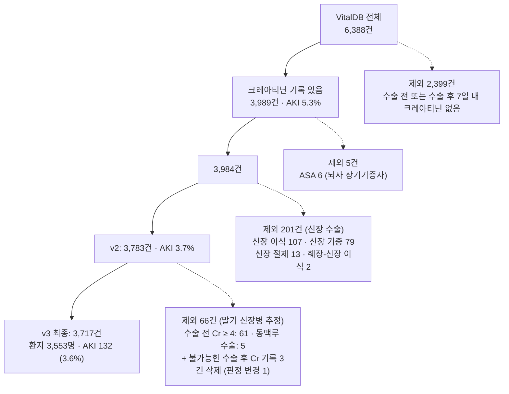
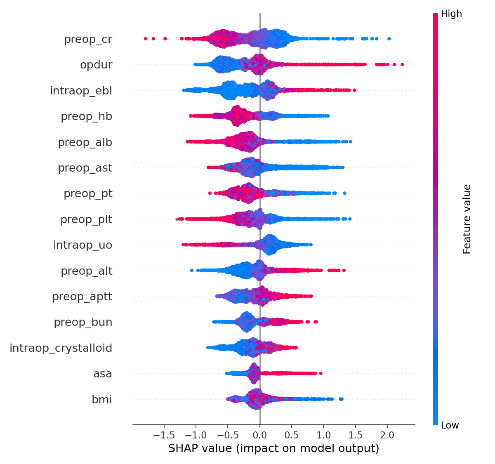

# VitalDB Postoperative AKI Prediction

공개 수술 데이터셋 VitalDB로 수술 후 7일 이내 급성 신손상(AKI) 예측.

- 데이터: VitalDB 비심장 수술 6,388건 → 최종 3,717건 (환자 3,553명, AKI 132명 = 3.6%)
- 모델: Logistic Regression, XGBoost
- 검증: 환자 단위 5-fold 교차검증, OOF 예측 부트스트랩 95% CI
- 결과: CV AUROC 0.81–0.84. LR vs XGB 차이 확인 X
- 상태: **탐색적 분석, 진행 중**. 여러 결정을 결과 확인 후 내림 ([Limitations](#limitations))

## Table of Contents

- [Research Questions](#research-questions)
- [Dataset](#dataset)
- [Outcome Definition](#outcome-definition)
- [Cohort Selection](#cohort-selection)
- [Features](#features)
- [Method](#method)
- [Results](#results)
- [Limitations](#limitations)
- [Reproduce](#reproduce)
- [Roadmap](#roadmap)
- [Notes on AI Assistance](#notes-on-ai-assistance)
- [References](#references)

## Research Questions

1. 수술 전 정보만으로 수술 후 AKI 예측 가능한가
2. 수술 중 정보(총량, 혈압 요약) 추가 시 예측 개선되는가

| 모델 | 예측 시점 | 입력 |
|---|---|---|
| 수술 전 | 수술 직전 | 나이, ASA, 병력, 수술 전 검사, 계획된 수술 정보 |
| 수술 전+중 | 수술 종료 | 위 + 수술 시간, 출혈, 수혈, 수액, 약물, 소변량 |
| +혈압 | 수술 종료 | 위 + 수술 중 MAP 요약 변수 7개 |

- 수술 후 정보(ICU 재원, 원내 사망, 수술 후 크레아티닌) 모든 모델에서 제외 (누수 방지)

## Dataset

- **VitalDB**: 서울대병원 비심장 수술 6,388건 (2016–2017), API·`vitaldb` 패키지로 공개
- 사용 테이블: `cases` (수술 1건 = 1행), `labs` (검사 1회 = 1행), `trks` (신호 목록)
- 생체신호: `Solar8000/ART_MBP`, `Solar8000/NIBP_MBP`, `Solar8000/HR`, 승압제 펌프 신호 (`PHEN_RATE`, `NEPI_RATE`, `DOPA_RATE`)
- 라이선스: **미확인** — 공개 전 vitaldb.net에서 확인 예정
- 데이터 파일 저장소 미포함

## Outcome Definition

- **주 정의**: 수술 후 7일 이내 최고 크레아티닌 ≥ 수술 전 크레아티닌 × 1.5 (KDIGO 기준 일부)
- **민감도 분석**: KDIGO — 7일 내 1.5배 **또는** 48시간 내 0.3 mg/dL 이상 상승
- 소변량 기준 미사용 (수술 후 기록 없음)
- 구조적 한계: 비율 기준 → 기저치 낮으면(< 0.6) 작은 변화로도 AKI, 만성 신장병은 큰 상승 필요

## Cohort Selection



| 제외 단계 | 근거 |
|---|---|
| 크레아티닌 없음 | 비교값 없음 → AKI 판단 불가 |
| ASA 6 | 수술 후 경과 개념 없음 |
| 신장 수술 | 신장 개수·상태 변화 → 비율 무의미 (기증자 상승, 수혜자 하락) |
| 말기 신장병 | 기저치가 말기 수치, 투석 일정에 따라 변동 |
| 수술 후 Cr > 15 & 수술 전 < 4 | 생리적 상승 범위 초과 (원인 미확인) |

**선택 편향** (포함 3,989 vs 제외 2,399, 평균)

| 특성 | 제외군 | 포함군 |
|---|---|---|
| 나이 | 53.9 | 59.3 |
| ASA | 1.70 | 1.93 |
| 응급 수술 | 12% | 13% |
| 수술 시간(분) | 86 | 166 |
| ICU 재원(일) | 0.41 | 0.64 |

- 포함군이 큰 수술 쪽으로 치우침
- TODO: t-검정(연속형)·카이제곱(범주형) p-value 포함 Table 1 (`tableone`)

## Features

| 세트 | 변수 수 | 내용 |
|---|---|---|
| 수술 전 | 39 | 숫자 15, 이진 6 (성별, 응급, 고혈압, 당뇨, ECG 이상, PFT 이상), 원-핫 18 (진료과, 수술 종류, 접근법) |
| 수술 중 | +20 | 수술 시간, 출혈량, 소변량, 수액, 수혈, 약물, 수혈 여부, 결측 지시 변수 3 |
| 혈압 | +7 | `art_used`, `valid_min`, `min_below65`, `pct_below65`, `auc65`, `map_min`, `map_mean` |

전처리

- 결측: 수술 전 검사·출혈량·소변량·정질액 → train 중앙값 대체 (파이프라인 내부). 출혈·소변·정질액은 결측 지시 변수 추가
- 약물·수혈: 미투여 = 0으로 기록됨
- ABGA 6항목: 결측 약 90% → 제외
- 기록 오류: 적혈구 > 30 unit & 출혈 < 1,000 mL 3건 → 결측 처리 (수혈 여부 변수 유지)
- LR: 표준화, 치우친 수술 중 변수·`min_below65`·`auc65`에 `log1p`
- 혈압: 마취 구간만, 20 미만·200 초과 제거. 동맥 라인 1분 중앙값 → 3분 이동 중앙값, 커프 최대 10분 유지. 동맥 라인 값이 마취 시간 50% 이상이면 동맥 라인 사용

## Method

- 분할: `StratifiedGroupKFold(n_splits=5, shuffle=True, random_state=42)` — 환자(`subjectid`) 단위, AKI 비율 층화
- LR: `SimpleImputer(median)` → `StandardScaler` → `LogisticRegression(max_iter=1000)`
- XGB: `n_estimators=300, max_depth=3, learning_rate=0.05, subsample=0.8, colsample_bytree=0.8` (튜닝 X)
- 지표: AUROC, AUPRC (기준선 = 발생률 0.036)
- 불확실성: CV 평균 ± SD, OOF 예측 환자 단위 부트스트랩 95% CI (1,000회), 모델 간 짝지은 차이
- 보정: 보정 곡선, Brier score, 예측 평균 vs 실제 비율, 보정 기울기
- 해석: LR 계수, SHAP (OOF 방식)

## Results

v3 코호트, 주 정의 기준.

### 교차검증 (mean ± SD)

| 모델 | AUROC | AUPRC |
|---|---|---|
| LR · 수술 전 | 0.808 ± 0.054 | 0.338 ± 0.108 |
| XGB · 수술 전 | 0.807 ± 0.064 | 0.327 ± 0.132 |
| LR(log) · 수술 전+중 | 0.823 ± 0.069 | 0.340 ± 0.108 |
| XGB · 수술 전+중 | 0.839 ± 0.055 | 0.350 ± 0.136 |
| LR(log) · +혈압 | 0.813 ± 0.063 | 0.331 ± 0.111 |
| XGB · +혈압 | 0.835 ± 0.054 | 0.321 ± 0.123 |

### OOF 성능 (95% CI, 환자 단위 부트스트랩)

| 모델 | AUROC | AUPRC |
|---|---|---|
| LR 수술 전 | 0.792 [0.744–0.840] | 0.295 [0.194–0.420] |
| XGB 수술 전 | 0.786 [0.739–0.833] | 0.281 [0.183–0.406] |
| LR 수술 전+중 | 0.802 [0.751–0.850] | 0.293 [0.190–0.412] |
| XGB 수술 전+중 | 0.822 [0.777–0.864] | 0.303 [0.210–0.428] |
| LR +혈압 | 0.794 [0.742–0.842] | 0.298 [0.186–0.421] |
| XGB +혈압 | 0.816 [0.769–0.861] | 0.274 [0.190–0.391] |

| AUROC 차이 (뒤 − 앞) | 차이 [95% CI] |
|---|---|
| LR: 수술 전 → 수술 전+중 | +0.009 [−0.012, +0.029] |
| **XGB: 수술 전 → 수술 전+중** | **+0.035 [+0.009, +0.062]** |
| 수술 전: LR → XGB | −0.007 [−0.038, +0.024] |
| 수술 전+중: LR → XGB | +0.019 [−0.013, +0.049] |
| LR: 수술 전+중 → +혈압 | −0.008 [−0.014, −0.002] |
| XGB: 수술 전+중 → +혈압 | −0.005 [−0.017, +0.007] |

- 6개 비교 중 2개 CI가 0 미포함
- 다중 비교 고려 시 혈압 −0.008은 우연과 구분 어려움

### Subgroup (OOF AUROC)

| 모델 | 전체 | 간이식 제외 (3,629) | 간이식만 (88, AKI 33) |
|---|---|---|---|
| LR 수술 전 | 0.792 | 0.735 | 0.695 |
| XGB 수술 전 | 0.786 | 0.730 | 0.704 |
| LR 수술 전+중 | 0.802 | 0.747 | 0.718 |
| XGB 수술 전+중 | 0.822 | 0.774 | 0.741 |

- 전체 AUROC > 두 하위 그룹 → 성능 일부가 그룹 간 구분(간이식 vs 일반 수술)에서 나옴
- 간이식만 그룹: 표본 작음, 변화 해석 X

### Calibration

| 모델 | Brier (기준 0.0343) | 예측 평균 (실제 0.0355) | 보정 기울기 |
|---|---|---|---|
| LR 수술 전 | 0.0297 | 0.0360 | 0.72 |
| XGB 수술 전 | 0.0298 | 0.0292 | 0.68 |
| LR 수술 전+중 | 0.0304 | 0.0364 | 0.62 |
| XGB 수술 전+중 | 0.0291 | 0.0281 | 0.68 |

- 기울기 < 1 → 예측이 과하게 극단적
- XGB 전체 위험 약 20% 과소 예측
- 확률 그대로 사용 시 재보정 필요

### Sensitivity: KDIGO 정의

- AKI 132 → 175 (4.7%). 추가 43명 모두 기저 Cr ≥ 0.63 (중앙값 1.06)

| 모델 | AUROC (CV) | AUPRC (CV) |
|---|---|---|
| LR · 수술 전 | 0.826 ± 0.053 | 0.376 ± 0.064 |
| XGB · 수술 전 | 0.809 ± 0.037 | 0.347 ± 0.064 |
| LR(log) · 수술 전+중 | 0.831 ± 0.054 | 0.381 ± 0.091 |
| XGB · 수술 전+중 | 0.820 ± 0.043 | 0.371 ± 0.091 |

- "LR ≈ XGB" 유지
- "수술 전+중에서 XGB 우위" 유지 X. XGB 수술 중 변수 효과 +0.011 (주 정의 +0.032)

### 혈압 요약 변수

- 3,716건 생성 (1건 유효 MAP 없음), 동맥 라인 사용 70%, MAP < 65 시간 중앙값 7분 (평균 17.6)
- 극단값 256건 (6.9%): 동맥 라인 − 커프 차이 분포가 일반 환자와 유사 (|차이| > 20 mmHg: 7.8% vs 8.0%) → 센서 높이 오류 가설 지지 X
- 혈압 변수 추가로 성능 향상 X
  - 동맥 라인 유무 제외: 0.834
  - 극단값 256건 혈압 제외 (사전 지정 민감도 분석): 0.831

### 승압제 지속주입·심박수 (추가 분석, 진행 중)

- 펌프 신호 기준 승압제 지속주입 168건 (4.5%), 주입 시간 중앙값 122.5분
- `trks` 신호 목록과 지속주입 여부 완전 일치
- 환자별 수술 중 평균 HR: 평균 72 (범위 45–140)
- 1건 네트워크 오류 → 재추출 예정
- 모델 결과 (H1: 승압제 2변수, H2: 심박수 3변수, 각각 수술 전+중 대비) **미확정**

### SHAP (XGB · 수술 전+중)



- 수술 전 크레아티닌 중요도 1위. 낮을수록 위험 상승 방향 (정의 특성 반영)
- 간경화 패턴 (낮은 알부민·혈소판·PT 활성도, 높은 ALT) → 위험 쪽
- 수술 시간, 출혈량, 소변량(적을수록 위험) 상위권
- 승압제 bolus 총량 상위 15개에 없음
- 예측 모델 → 방향을 인과로 해석 X

## Limitations

**탐색적 분석**
- 제외 기준, 오류 기준, 로그 변환, KDIGO 정의 등 여러 결정을 결과 확인 후 결정
- 별도 hold-out test 없음. 모든 비교가 같은 3,717건·같은 분할
- 부트스트랩은 OOF 예측 고정 방식 → CI 다소 좁을 수 있음

**기타**
- AKI 정의가 기저 크레아티닌에 따라 다르게 작동
- 선택 편향: 큰 수술 쪽 치우침
- 단일 기관·단일 시기, 외부 검증 X
- `cases` 약물 변수는 bolus만 포함 추정. 지속주입은 펌프 신호에서 별도 추출 (추가 분석)
- 다중공선성 → 계수·SHAP 방향 인과 해석 X
- 보정 부족, XGB 튜닝 X
- 미확인 가설: 배액관 크레아티닌, 삼차성 부갑상선 기능 항진증, 흉부 수술 수액 제한, `trks` 목록 누락 원인

## Reproduce

환경: Google Colab, 산출물은 Google Drive `MyDrive/vitaldb-aki/`에 저장

1. 노트북 맨 위 세팅 셀 실행 → Drive 마운트 `True` 확인
2. 런타임 → 모두 실행 (`random_state=42`)
3. 생체신호 변수: `data/bp_features.csv`, `data/hr_vaso_features.csv` 있으면 추출 건너뜀
   - 처음부터 추출 시 파일 삭제 후 `RUN_HEAVY = True` (혈압 약 75분)

```
vitaldb-aki/
├── data/      # cases, labs, trks, bp_features, hr_vaso_features (.csv)
├── outputs/   # aki_dataset(_v2, _v3), oof_all_v3, oof_kdigo_v3, lr_coef_v3, shap_importance_v3
├── figures/   # shap_summary_v3, shap_dependence_cr_v3, shap_dependence_cr_kdigo_v3, calibration_v3
└── models/
```

## Roadmap

- [ ] 승압제·심박수 모델 결과 확정 (H1, H2)
- [ ] Table 1 (포함/제외군, t-검정·카이제곱)
- [ ] VitalDB 라이선스 확인
- [ ] 재보정, 중첩 교차검증으로 튜닝
- [ ] 노트북 정리 후 저장소 업로드

## Notes on AI Assistance

- 의대 예과생 자기주도 학습 포트폴리오
- 코드 대부분 Claude(AI 어시스턴트) 도움으로 작성
- 작성자 역할: 단계별 실행, 결과 확인, 의학 개념 학습, 분석 결정

## References

- Lee HC, Park Y, Yoon SB, et al. VitalDB, a high-fidelity multi-parameter vital signs database in surgical patients. *Sci Data*. 2022.
- KDIGO Clinical Practice Guideline for Acute Kidney Injury. *Kidney Int Suppl*. 2012.
- Christodoulou E, Ma J, Collins GS, et al. A systematic review shows no performance benefit of machine learning over logistic regression for clinical prediction models. *J Clin Epidemiol*. 2019.
